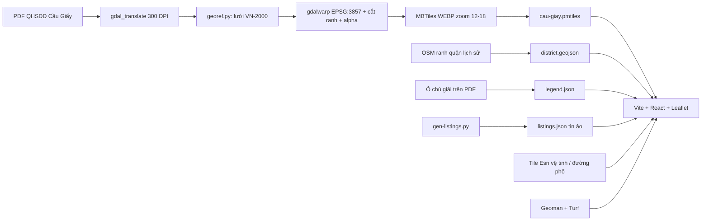
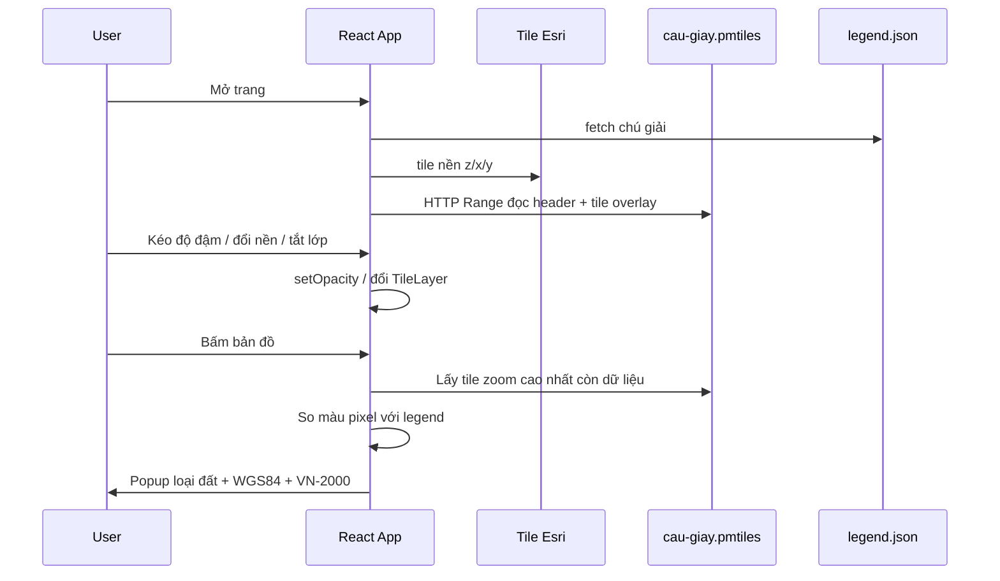
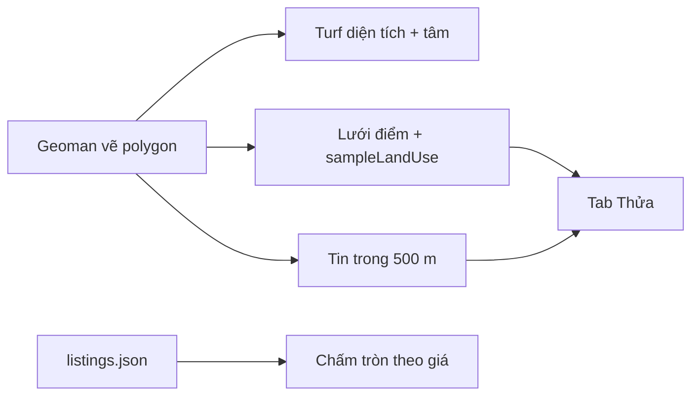
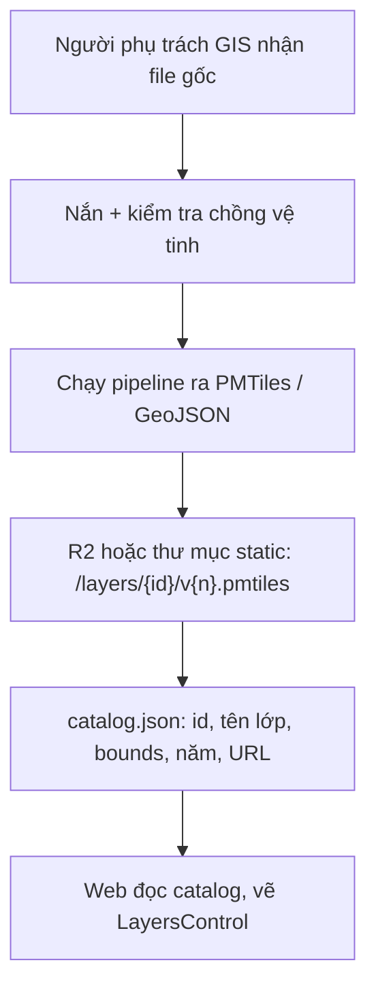

# Hướng dẫn demo soi quy hoạch và lộ trình lên sản phẩm

Tài liệu này mô tả demo hiện tại (quận Cầu Giấy cũ), các bước đã làm, cách vận hành, cách cập nhật dữ liệu, những việc cần đổi khi làm sản phẩm thật, và cách giữ chi phí gần 0 đồng càng lâu càng tốt.

Demo **không có giá trị pháp lý**. Bản đồ quy hoạch là PDF công khai của Sở TN-MT Hà Nội (bản đăng lại), chỉ dùng nội bộ để học kiến trúc.

---

## 1. Demo đang làm được gì

Trang web một tỉnh/một quận, bắt chước phần "soi quy hoạch" của [guland.vn](https://guland.vn/soi-quy-hoach/ha-noi):

- Nền vệ tinh hoặc nền đường phố, ghi nguồn Esri.
- Lớp quy hoạch sử dụng đất đến 2030 đè đúng vị trí lên nền.
- Thanh kéo độ đậm (opacity), bật/tắt lớp quy hoạch và ranh quận.
- Bảng chú giải 32 mã đất (ODT, TMD, DGT...).
- Bấm bản đồ: đoán loại đất theo màu pixel, hiện tọa độ WGS84 và VN-2000 (X bắc, Y đông).
- **Vẽ thửa:** công cụ đa giác góc trên phải (Leaflet-Geoman). Panel tab Thửa hiện diện tích, tâm VN-2000, tỷ lệ loại đất **ước lượng** (lấy mẫu màu raster trong thửa, không phải giao vector).
- **Bản đồ giá:** ~70 tin ảo trong ranh Cầu Giấy, chấm tròn tô màu theo đ/m². Khi đã vẽ thửa, tab Thửa liệt kê tin trong bán kính 500 m (min / trung vị / max).

**Chưa có:** % quy hoạch chính xác (cần lớp vector), tin giá thật, lưu thửa lên server, tìm tờ/thửa, OCR góc ranh, tài khoản, backend.

Chạy local:

```bash
cd web
nvm use          # Node 22, xem .nvmrc
pnpm install
pnpm dev         # http://localhost:5173
```

---

## 2. Kiến trúc demo



Mọi thứ chạy trên trình duyệt. Không có API, không có database. File tile (~7,4 MB) nằm trong `web/public/data/` và được thư viện `pmtiles` đọc bằng HTTP Range.

| Thành phần | Công nghệ | Chi phí |
| --- | --- | --- |
| Nắn ảnh, cắt tile | QGIS LTR, GDAL, Python (numpy), `pmtiles` CLI | Miễn phí |
| Web | Vite, React, Leaflet, react-leaflet, proj4js, Leaflet-Geoman, Turf.js | Miễn phí |
| Tile quy hoạch | Một file `.pmtiles` (WEBP) | Tự host, miễn phí |
| Nền bản đồ | Esri World Imagery / World Street Map | Demo: ghi nguồn. Thương mại: cần tài khoản ArcGIS |
| Hosting | Cloudflare Pages (gói Free) | Miễn phí trong hạn mức |
| File tile lớn về sau | Cloudflare R2 | 10 GB + không tính băng thông tải ra ở free tier |

---

## 3. Cấu trúc thư mục

```
guland/
  README.md                 Chạy nhanh
  docs/huong-dan.md         Tài liệu này
  data-prep/
    README.md               Chi tiết nắn ảnh VN-2000
    scripts/
      01-download.sh        Tải PDF từ Google Drive (gdown)
      02-district.sh        Ranh quận từ Overpass (mốc 2025-05-01)
      03-tiles.sh           PDF -> GeoTIFF -> PMTiles
      find_grid.py          Dò đường lưới xanh lơ
      georef.py             Gán tọa độ VN-2000
      legend.py             Lấy màu chú giải -> legend.json
      gen-listings.py       Sinh tin rao ảo trong ranh quận
    raw/                    PDF, OSM gốc (gitignore)
    work/                   File trung gian TIFF/MBTiles (gitignore)
  web/
    public/data/            cau-giay.pmtiles, district.geojson, legend.json, listings.json
    src/
      App.tsx
      components/           MapView, LayerPanel, Legend, DrawControl, ParcelPanel, PriceLayer, PriceLegend
      lib/pmtilesLayer.ts   GridLayer Leaflet đọc PMTiles
      lib/landUse.ts        Đoán mã đất theo màu + mix trong thửa
      lib/parcel.ts         Diện tích / tâm / lưới điểm (Turf)
      lib/listings.ts       Thang màu giá, tin trong 500 m
      lib/vn2000.ts         WGS84 <-> VN-2000 Hà Nội
```

---

## 4. Các bước thực hiện (đã làm)

Làm lại từ đầu khi đổi máy hoặc đổi quận.

### 4.1 Cài công cụ (một lần)

```bash
brew install gdal pmtiles pipx
pipx install gdown
brew install --cask qgis-ltr   # chỉ cần khi nắn bằng tay
# Node ^20.19 hoặc >=22.12, pnpm. Vite 8 không chạy Node 21.
```

Python GIS dùng `/opt/homebrew/bin/python3` (đi kèm GDAL Homebrew), không dùng Python.org 3.8.

### 4.2 Tải dữ liệu

```bash
./data-prep/scripts/01-download.sh
./data-prep/scripts/02-district.sh
```

- PDF chính: Cầu Giấy 2030, ~7,2 MB, link `https://bit.ly/3zMc7bX`. Nếu Google chặn, script thử Thanh Xuân, Đống Đa, Tây Hồ. Nếu vẫn fail: tải tay, đặt vào `data-prep/raw/cau-giay-qhsdd-2030.pdf`.
- Ranh quận: OSM relation `9421132` tại **2025-05-01**. Từ 01/07/2025 Việt Nam bỏ cấp huyện; OSM hiện tại không còn "Quận Cầu Giấy".

### 4.3 Nắn ảnh và cắt tile

```bash
./data-prep/scripts/03-tiles.sh
/opt/homebrew/bin/python3 data-prep/scripts/legend.py \
  data-prep/work/qh.tif web/public/data/legend.json
```

Pipeline trong `03-tiles.sh`:

1. `gdal_translate` PDF -> GeoTIFF 300 DPI.
2. `georef.py` dò lưới 500 m màu xanh lơ, neo:
   - x = 1604 px -> Easting 579 500
   - y = 2662 px -> Northing 2 329 500
   Sai số khớp lưới dưới 0,35 m (xem [data-prep/README.md](../data-prep/README.md)).
3. `gdalwarp` sang EPSG:3857, cắt theo ranh quận nới 60 m, trắng giấy -> trong suốt.
4. `gdal_translate -of MBTILES` WEBP quality 90, `gdaladdo` tạo zoom thấp, `pmtiles convert`.
5. Copy `district.geojson` vào `web/public/data/`.

Nếu PDF không có lưới hoặc bị nghiêng: nắn tay trong QGIS (mục "Nắn bằng tay" ở `data-prep/README.md`), xuất `work/qh_vn2000.tif`, rồi chạy phần còn lại của `03-tiles.sh`.

### 4.4 Web

1. Vite + React + Leaflet; lớp quy hoạch là `PmtilesRasterLayer` (GridLayer đọc blob WEBP từ archive).
2. Nền Esri vì `tile.openstreetmap.org` hay bị chặn ở Việt Nam, CARTO đã bắt API key.
3. Click: `sampleLandUse` lấy tile (hạ dần zoom nếu ô zoom 18 bị GDAL bỏ vì trong suốt), so màu với `legend.json` (ngưỡng khoảng cách 30). Nhiều mã đất cùng màu nên popup có thể ra một nhóm mã.
4. VN-2000: proj string Hà Nội TM-3, kinh tuyến 105°, k = 0,9999. Tham số `+towgs84` đổi dấu 3 góc so với bảng EPSG:6960 (coordinate frame vs position vector). **Mỗi tỉnh có kinh tuyến trục khác nhau** — không copy nguyên hàm này cho Đà Nẵng hay TP.HCM.
5. Vẽ thửa: `@geoman-io/leaflet-geoman-free`, một polygon, sửa/xóa được. Diện tích `@turf/area`. Khi đang vẽ, tắt popup click quy hoạch.
6. Giá: `listings.json` do `gen-listings.py` (seed 42, 70 điểm trong district). Chấm tròn xanh→đỏ theo đ/m².

### 4.5 Deploy (khi cần gửi link)

Bản public hiện tại: **https://phonghuynhitn.github.io/guland/** — `git push` `main` là GitHub Actions deploy.

Cloudflare Pages (tùy chọn, URL gốc `/`):

```bash
cd web
pnpm exec wrangler login
pnpm deploy
```

Giới hạn Cloudflare Pages: **25 MiB / file**. File hiện tại 7,4 MB nên để chung `dist/` được. Nhiều quận / file lớn hơn: đưa `.pmtiles` lên R2 (public, CORS `GET` + header `Range`), build với:

```bash
VITE_PLANNING_URL=https://<r2-public-domain>/cau-giay.pmtiles pnpm deploy
```

---

## 5. Luồng vận hành (runtime)

Không có server nghiệp vụ. Trình duyệt làm hết.



Điểm vận hành cần nhớ:

- Overlay chỉ có **zoom 12–18**. Zoom sâu hơn Leaflet phóng to tile (vỡ hình là giới hạn PDF tỷ lệ ~1/5000, không phải lỗi code).
- GDAL không ghi tile hoàn toàn trong suốt. Click sát rìa có thể phải hạ zoom mới ra màu.
- `maxBounds` khóa tầm nhìn quanh Hà Nội để khỏi kéo sang chỗ không có dữ liệu.

### 5.1 Luồng dùng vẽ thửa và giá

1. Tab **Lớp**: bật "Tin rao (demo)" nếu muốn thấy chấm giá.
2. Tab **Giá**: xem thang màu đ/m² và vài tin đắt nhất.
3. Tab **Thửa** hoặc nút đa giác góc trên phải: click từng đỉnh, khép ranh.
4. Sửa đỉnh (icon edit) hoặc xóa (icon thùng rác). Vẽ polygon mới thì thửa cũ bị thay.
5. Panel Thửa: diện tích, VN-2000 tâm, % loại đất ước lượng, tin trong 500 m.



---

## 6. Luồng cập nhật dữ liệu

### 6.1 Cách đang dùng (thủ công, đủ cho demo)

Mỗi lần có PDF quy hoạch mới hoặc đổi quận:

```text
1. Nhận file PDF/CAD (đặt vào data-prep/raw/)
2. Kiểm tra preview.png: có lưới VN-2000 không, có bị nghiêng không
3. Đọc nhãn lưới -> sửa --anchor-* của georef.py nếu khác Cầu Giấy
4. Chạy 02-district.sh (hoặc thay GeoJSON ranh mới)
5. Xóa data-prep/work/qh.tif nếu đổi PDF, chạy 03-tiles.sh + legend.py
6. Mở QGIS hoặc web, đối chiếu đường/sông với ảnh vệ tinh (sai số mong muốn < 10 m)
7. (Tuỳ chọn) `/opt/homebrew/bin/python3 data-prep/scripts/gen-listings.py` nếu đổi ranh quận
8. pnpm dev kiểm tra; git push main để GitHub Pages cập nhật (hoặc `pnpm deploy` Cloudflare)
```

File lớn (`raw/`, `work/`) không commit. Chỉ commit script, `legend.json`, `district.geojson`, và `.pmtiles` nếu muốn người khác clone là chạy được.

Gợi ý đặt tên khi có nhiều khu:

```text
web/public/data/
  cau-giay-qhsdd-2030.pmtiles
  cau-giay-boundary.geojson
  cau-giay-legend.json
```

Web đọc URL theo tỉnh/phường thay vì hard-code một file.

### 6.2 Cách nên dùng khi thành sản phẩm (vẫn có thể miễn phí)

Tách **kho dữ liệu** khỏi **code web**.



`catalog.json` mẫu (host tĩnh, không cần backend):

```json
{
  "layers": [
    {
      "id": "hn-cau-giay-qhsdd-2030",
      "title": "QH sử dụng đất Cầu Giấy đến 2030",
      "type": "raster",
      "url": "https://data.example.com/layers/cau-giay-qhsdd-2030.pmtiles",
      "legend": "https://data.example.com/layers/cau-giay-legend.json",
      "bounds": [105.7666, 21.0002, 105.8141, 21.0593],
      "publishedAt": "2026-10-07",
      "source": "Sở TN-MT Hà Nội"
    }
  ]
}
```

Quy ước vận hành:

- **Không sửa file đang phục vụ.** Lớp mới = `v2.pmtiles`, rồi sửa catalog trỏ sang v2. Giữ v1 vài tuần để rollback.
- Ghi nhật ký: nguồn file, ngày nhận, người nắn, sai số ước lượng, quyết định phê duyệt (số QĐ).
- Một "khu vực" có thể có nhiều lớp: QH sử dụng đất, QH phân khu, kế hoạch năm. User bật từng lớp + kéo opacity như Guland.

### 6.3 Cập nhật dữ liệu giá

Hiện tại chỉ thay file tĩnh:

```bash
/opt/homebrew/bin/python3 data-prep/scripts/gen-listings.py
# hoặc sửa tay web/public/data/listings.json
```

Mỗi tin: `id`, `lat`, `lng`, `areaM2`, `pricePerM2`, `type` (`nha`|`dat`), `title`, `address`. Giá trong file là **ảo**, chỉ để có độ tương phản trên bản đồ (phía đông đắt hơn phía tây).

Khi lên sản phẩm: user tự đăng tin, hoặc nhập từ đối tác. Không crawl trang khác. Catalog/API có thể thay `listings.json` mà không đổi UI chấm tròn.

Khi nào mới cần backend: tài khoản, tin đăng bán, phân quyền "lớp trả phí", tìm thửa trong PostGIS. Raster quy hoạch **không bắt buộc** có API.

---

## 7. Lưu ý khi phát triển thành dự án thật

### 7.1 Dữ liệu và pháp lý (rủi ro lớn nhất)

- PDF/CAD công khai **không đồng nghĩa** được quyền thương mại hóa. Trước khi public: lấy từ cổng Sở / thủ tục cung cấp thông tin, ghi nguồn, disclaimer "không thay thế hồ sơ pháp lý".
- Dữ liệu địa chính (tờ, thửa) do Văn phòng đăng ký đất đai quản lý, có thu phí, hạn chế dùng thương mại. Demo cố tình không đụng phần này.
- Không crawl tile/API của Guland hay Google. Học kiến trúc thì quan sát DevTools, không tải hàng loạt.
- Nghị định 13/2023 nếu lưu SĐT, tin đăng, vị trí nhà người dùng.

### 7.2 Raster (demo) vs vector (sản phẩm soi thửa)

| | Raster PMTiles như demo | Vector (GeoJSON / vector tiles / PostGIS) |
| --- | --- | --- |
| Làm | Nhanh, giữ nguyên màu bản đồ giấy | Chậm: phải số hóa từng vùng |
| Click | Đoán theo màu, dễ nhầm mã cùng màu | Click đúng polygon, mã đất chắc |
| Tính % thửa dính QH | Không làm được tốt | `ST_Intersection` + `ST_Area` |
| Chi phí | Gần 0 | Nhân công số hóa là khoản lớn |

Lộ trình hợp lý: **giữ raster để xem**, song song số hóa vector từng phường khi có CAD/SHP hoặc thuê vẽ. Đừng số hóa cả thành phố trước khi có user.

### 7.3 Hệ tọa độ

- Sổ đỏ ghi VN-2000. Bản đồ web dùng WGS84 / Web Mercator.
- Mỗi tỉnh một kinh tuyến trục (Hà Nội 105°00'). Bảng tra cứu bắt buộc, không hard-code một proj string.
- Kiểm tra chéo bằng phần mềm chuyển đổi VN-2000 của ngành TN-MT trước khi tin tọa độ góc ranh.

### 7.4 Đơn vị hành chính sau 01/07/2025

QH cũ vẽ theo quận/huyện. URL và bộ lọc nên theo **tỉnh + xã/phường mới**, kèm bảng ánh xạ "quận cũ -> các phường mới". Ranh OSM lấy `[date:"..."]` như demo đang làm.

### 7.5 Nền bản đồ

- OSM.org cấm dùng tile `tile.openstreetmap.org` cho sản phẩm. Tự host: [Protomaps](https://protomaps.com/) / PMTiles OSM, hoặc OpenFreeMap.
- Ảnh vệ tinh độ phân giải đủ để vẽ thửa: Esri/Google/Mapbox có điều khoản thương mại. Sentinel-2 (10 m) miễn phí nhưng quá thô.
- Demo dùng Esri vì xem được từ Việt Nam và chưa cần API key. **Trước khi ra mắt:** đăng ký ArcGIS Location Platform (có free tier) hoặc đổi nhà có gói miễn phí đủ hạn mức.

### 7.6 Leaflet có đủ không

Leaflet đủ cho overlay raster + vẽ thửa (Leaflet-Geoman, miễn phí) + vài chục chấm giá. Chuyển MapLibre hoặc thêm Leaflet.markercluster khi có vector tiles / hàng trăm tin, hoặc cần nghiêng bản đồ. Không cần đổi ngay.

### 7.7 Tính năng còn lại — thứ tự nên làm

1. Catalog nhiều lớp / nhiều phường (vẫn static files).
2. Ô nhập tọa độ VN-2000 hoặc WGS84 để bay đến điểm (`vn2000.ts` đã có).
3. Geocoding: Nominatim tự host (địa chỉ VN trung bình) hoặc Goong/Vietmap khi có ngân sách.
4. Vector + PostGIS khi cần % diện tích loại đất **chính xác** (demo hiện chỉ lấy mẫu màu).
5. Tin giá thật do user đăng; cluster khi > vài trăm điểm.
6. OCR góc ranh: Tesseract/PaddleOCR tự host.
7. App mobile sau khi web ổn.

### 7.8 Hiệu năng

- Một quận ~7–20 MB WEBP. Cả Hà Nội raster 1/2000 có thể hàng GB: chia theo phường, chỉ tải lớp đang bật.
- Pages 25 MiB/file: mặc định đưa tile sang R2 khi vượt.
- PMTiles cần HTTP `Range`. R2 và Pages đều hỗ trợ.

---

## 8. Chi phí: ưu tiên miễn phí

Giá nhà cung cấp hay đổi. Kiểm tra lại trang pricing trước khi khóa stack.

### 8.1 Demo / MVP nội bộ: 0 đồng

| Khoản | Lựa chọn miễn phí |
| --- | --- |
| Máy dev | Mac sẵn có + Homebrew |
| GIS | QGIS, GDAL, tippecanoe/pmtiles, Python |
| Code | Leaflet, React, Vite, proj4, PMTiles, Leaflet-Geoman, Turf |
| Dữ liệu QH demo | PDF công khai (chỉ nội bộ) |
| Tin giá demo | `listings.json` sinh local, 0 đồng |
| Ranh hành chính | OSM, ghi nguồn ODbL |
| Chạy local | `pnpm dev` |
| Gửi link xem | Cloudflare Pages Free + (nếu cần) R2 Free 10 GB, không phí egress |

Chưa cần Vercel Pro, Mapbox, Google Maps, AutoCAD, RDS.

### 8.2 Public beta, ít user, vẫn bám free tier

| Khoản | Đề xuất miễn phí | Khi nào mới phải trả |
| --- | --- | --- |
| Web | Cloudflare Pages | Domain tùy chọn (~100–200k VND/năm) |
| Tile tự tạo | R2 Free | hơn 10 GB lưu trữ |
| Nền đường phố | Tự host OSM PMTiles trên R2 | Quá lớn / quá nhiều request thì CDN trả phí |
| Nền vệ tinh | ArcGIS Location Platform free tier, ghi nguồn | Vượt credit hoặc điều khoản thương mại |
| Geocoding | Nominatim tự host trên VPS rẻ / máy nhà | User phàn nàn địa chỉ VN -> Goong/Vietmap |
| Auth | Magic link email (Resend free tier) hoặc đăng nhập Google | SMS OTP thì tính từng tin |
| Lỗi / thống kê | Cloudflare Web Analytics, hoặc tự log | Sentry vượt free tier |
| OCR | Tesseract / PaddleOCR trên máy xử lý dữ liệu | Cloud Vision khi cần độ chính xác |

VPS chỉ cần khi tự host Nominatim hoặc PostGIS: Hetzner/Viettel/BizFly entry ~ vài USD đến vài trăm nghìn VND/tháng. **Có thể trì hoãn** nếu chưa có vector/geocoding.

### 8.3 Khoản không nên giả miễn phí

Những thứ này thường **không có bản miễn phí hợp pháp** nếu làm sản phẩm:

1. **Giấy phép dùng thương mại ảnh vệ tinh độ nét cao** — bắt buộc nếu user vẽ thửa trên nền vệ tinh.
2. **File quy hoạch/địa chính gốc** — thủ tục nhà nước hoặc mua từ đơn vị đo đạc; nhân công nắn/số hóa.
3. **Crawl tin rao / tile đối thủ** — rủi ro pháp lý, không phải "tiết kiệm".
4. **Apple Developer** (99 USD/năm) khi có app iOS.

Đây là nơi Guland bỏ tiền thật (mua file cộng đồng, vệ tinh, dữ liệu). Phần mềm GIS thì họ cũng có thể dùng stack mã nguồn mở như demo.

### 8.4 Ngân sách tham khảo theo giai đoạn

| Giai đoạn | Hạ tầng / phần mềm | Dữ liệu + người |
| --- | --- | --- |
| Demo như hiện tại | 0 | 0 (PDF công khai, 1 quận) |
| 5–10 phường, chỉ raster | 0–20 USD/tháng nếu có VPS; có thể vẫn 0 với Pages+R2 | Thời gian GIS; xin/mua PDF |
| Có vẽ thửa + tin đăng, chưa vector QH | Pages + R2 + Auth.js/email: ~0–30 USD/tháng | Ảnh vệ tinh commercial; moderation tin |
| Vector + % quy hoạch + giá | VPS PostGIS ~10–50 USD/tháng | Số hóa: khoản lớn nhất, tính theo km² |

**Nguyên tắc:** đừng thuê Mapbox/Google/AutoCAD khi QGIS + Leaflet + R2 chưa hết hạn mức. Đừng dựng backend trước khi catalog file tĩnh không còn đủ.

---

## 9. Việc tiếp theo (gợi ý, chưa làm)

1. Catalog nhiều lớp, chọn phường trên cùng một bản đồ.
2. Ô nhập tọa độ VN-2000 / WGS84 (đã có `vn2000.ts`).
3. Xin file CAD/SHP một phường để thử lớp vector (thay cho % ước lượng từ raster).
4. Thay `listings.json` bằng tin user tự đăng.
5. GitHub Pages đã public tại https://phonghuynhitn.github.io/guland/; Cloudflare Pages khi cần Range tốt hơn cho file lớn.
6. Trước khi public: thay Esri bằng nguồn vệ tinh đã đọc điều khoản; giữ disclaimer giá ảo / không pháp lý.
