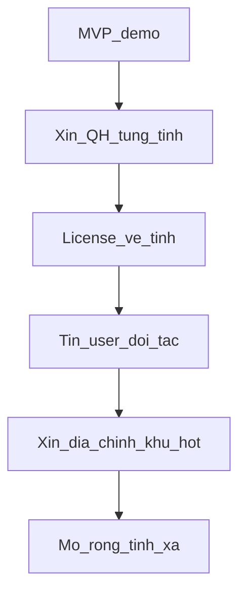

# Pháp lý khi làm ứng dụng giống Guland

Tài liệu nội bộ cho team: rủi ro và lộ trình hợp pháp khi làm app soi quy hoạch / tờ thửa / bản đồ giá. **Không phải tư vấn luật sư.** Trước khi thu phí hoặc quảng cáo rộng, nhờ luật sư đối chiếu văn bản gốc và điều khoản từng tỉnh.

Demo hiện tại ([README](../README.md), [huong-dan.md](huong-dan.md)) cố tình: QH raster từ PDF công khai, user tự vẽ thửa, tin giá ảo — **không** dùng địa chính tờ/thửa, **không** cào Guland.

---

## 1. Phạm vi

| Việc | Tài liệu này |
| --- | --- |
| Hiểu được / không được / cần xin gì | Có |
| Thay hợp đồng, giấy phép Sở, ý kiến luật sư | Không |
| Hướng dẫn scrape đối thủ | Không — cấm |

Ba mức sử dụng cần tách khi đọc mọi mục dưới đây:

1. **Xem công khai** — dân tra cứu trên cổng nhà nước / app chỉ hiển thị nguồn đã được phép.
2. **Demo nội bộ / học** — như repo này; disclaimer rõ; không thu phí.
3. **App thương mại** — host lại GIS, bán gói soi QH/thửa, quảng cáo — cần thủ tục + phí + license từng lớp dữ liệu.

---

## 2. Hai lớp dữ liệu cốt lõi

Ứng dụng kiểu Guland thường gộp nhiều lớp; pháp lý **không giống nhau**.

| Lớp | Bản chất kỹ thuật | Cơ quan / nguồn chuẩn | Demo repo |
| --- | --- | --- | --- |
| **Quy hoạch sử dụng đất** (QHSDĐ, kế hoạch SDĐ, đôi khi QHXD) | Raster tile hoặc vector mã đất | Sở TN-MT / công bố QH; khai thác qua hệ thống thông tin đất đai | Có (PMTiles Cầu Giấy) |
| **Địa chính** (số tờ, số thửa, viền thửa) | Vector polygon + thuộc tính | Văn phòng đăng ký đất đai (VPĐKĐĐ) / Chi nhánh / PVHCC | **Không có** |
| Nền vệ tinh / đường phố | Tile nhà cung cấp | Esri, Google, Mapbox, OSM tự host… | Esri (chỉ demo) |
| Tin giá / rao bán | Điểm + metadata | User đăng hoặc đối tác | Tin ảo |

Học kiến trúc Guland (Leaflet, API click thửa) chỉ để hiểu mô hình — **không** sao chép dữ liệu hay cào tile/API của họ.

---

## 3. Bản đồ quy hoạch: công khai ≠ free thương mại

### 3.1 Công bố để dân xem (Luật Đất đai 2024, Điều 75)

Sau phê duyệt, quy hoạch / kế hoạch sử dụng đất **phải công bố công khai** (thường chậm nhất 15 ngày; duy trì suốt kỳ QH). Tài liệu công bố gồm văn bản phê duyệt, thuyết minh và **bản đồ quy hoạch đã phê duyệt**.

→ Nội dung QH **không phải bí mật**. Người dân được biết / tra cứu tại trụ sở và cổng thông tin điện tử.

### 3.2 Khai thác file / GIS để làm sản phẩm

Lấy bản đồ hoặc dữ liệu không gian từ **Hệ thống thông tin quốc gia về đất đai** (và thủ tục cung cấp thông tin đất đai / TN-MT tương ứng) thường qua:

- Phiếu / văn bản yêu cầu (khung liên quan: Nghị định 101/2024/NĐ-CP và các quy định cung cấp thông tin dữ liệu đất đai / TN-MT).
- **Phí khai thác, sử dụng** theo **Thông tư 56/2024/TT-BTC** (áp dụng từ 01/8/2024) — có biểu phí bản đồ QH / dữ liệu không gian QH–KHSDĐ theo cấp huyện / tỉnh / quốc gia (raster thường thấp hơn vector). Không mặc định “tải miễn phí để bán lại”.

PDF trên cổng Sở để **xem hoặc tải tham khảo** ≠ giấy phép **tái phân phối / tích hợp vào app thương mại**. Thực tế nhiều Sở cho xem PDF; dùng vào sản phẩm vẫn nên xin xác nhận mục đích và điều kiện từng tỉnh.

### 3.3 Bảng nhanh

| Việc | Thường |
| --- | --- |
| Tra cứu / xem QH đã công bố | Được (công khai theo luật) |
| Demo nội bộ từ PDF công khai + ghi nguồn + disclaimer | Thường chấp nhận được hơn (như demo này) |
| Host lại / bán dịch vụ soi QH trong app | Thủ tục cung cấp + phí / thỏa thuận Sở |
| Cào tile/WMS từ Guland thay nguồn nhà nước | **Rủi ro cao — không làm** |

---

## 4. Địa chính (tờ, thửa, viền đỏ)

### 4.1 Đây là gì trên sản phẩm kiểu Guland

Click map → viền đỏ một thửa + hiện số tờ / số thửa. Về kỹ thuật: **vector địa chính** trên server (point-in-polygon), không phải đoán màu từ PDF quy hoạch, và trình duyệt **không** đọc DWG/DXF lúc click.

### 4.2 Nguồn hợp pháp

- **VPĐKĐĐ / Chi nhánh / Trung tâm Phục vụ hành chính công** — phiếu yêu cầu cung cấp thông tin, dữ liệu đất đai; ghi rõ tờ bản đồ, xã/tỉnh, **mục đích sử dụng** (kể cả thương mại nếu làm app trả phí); trả phí theo quy định; tuân điều kiện cấp dữ liệu.
- Một số địa phương có WMS/WFS tham chiếu (vd. geoportal TN-MT) — vẫn hạn chế điều khoản, **không** thay hồ sơ pháp lý và không mặc định cho phép tái dùng thương mại tự do.
- Định dạng giao nộp / trung gian thực tế: thường **DGN**, đôi khi DWG/DXF/SHP từ đơn vị đo đạc → convert sang PostGIS / GeoPackage / vector tiles, gắn field số tờ / số thửa, VN-2000 đúng kinh tuyến tỉnh.

### 4.3 Không được coi là “đi tắt”

| Việc | Đánh giá |
| --- | --- |
| Cào API thửa / polygon từ Guland (hoặc đối thủ) | Rủi ro cao: ToS đối thủ + dữ liệu đất đai nhà nước |
| Xin vector đúng thủ tục rồi tự host API | Đường chuẩn thương mại |
| User tự vẽ ranh trên vệ tinh (như demo) | Không thay địa chính; không hiện số tờ/thửa pháp lý |

**Thiếu phiếu VPĐKĐĐ mà vẫn cào thửa từ Guland** → hai lớp rủi ro chồng nhau (nền tảng tư nhân + dữ liệu đất đai).

---

## 5. Cấm / rủi ro cao khi đi tắt

1. **Scraping tile hoặc API Guland** (QH hoặc thửa) để tự host / cạnh tranh.
2. **Crawl tin đăng, giá, SĐT** từ Guland hoặc sàn BĐS khác.
3. **Dùng nền vệ tinh “free demo”** (vd. Esri World Imagery ghi nguồn kiểu demo) cho sản phẩm thương mại mà không đăng ký gói commercial.
4. **Tự nhận “có giá trị pháp lý”** hoặc thay sổ đỏ / hồ sơ VPĐKĐĐ trên UI.
5. **Bán lại dữ liệu** đã xin theo mục đích A sang mục đích B trái cam kết trên phiếu.

Cho phép khi học: mở DevTools, đọc URL/kiến trúc — **không** tải hàng loạt.

---

## 6. Lớp phụ trợ khi thương mại hóa

### 6.1 Nền bản đồ

| Nguồn | Demo | Thương mại |
| --- | --- | --- |
| Esri World Imagery / Street Map | Thường ổn nếu ghi nguồn, hạn chế ToS | Cần tài khoản ArcGIS Location Platform (hoặc gói trả phí tương đương) |
| Google / Mapbox | Có điều khoản riêng | License trả phí / hạn mức |
| `tile.openstreetmap.org` | Không dùng cho sản phẩm | Cấm theo OSMF; tự host Protomaps / OpenFreeMap… |
| Sentinel-2 | Miễn phí nhưng ~10 m | Quá thô để vẽ thửa |

### 6.2 Tin giá / rao bán

- Chuẩn: **user tự đăng** hoặc nhập từ đối tác có hợp đồng.
- Không crawl tin đối thủ.
- Nếu lưu SĐT, vị trí nhà, tin đăng → tuân **Nghị định 13/2023** (bảo vệ dữ liệu cá nhân): thông báo, đồng ý, mục đích, lưu trữ, quyền chủ thể dữ liệu.

### 6.3 Disclaimer trên sản phẩm (bắt buộc về mặt sản phẩm)

Hiện rõ trên app (và điều khoản):

- Bản đồ QH / thửa trên app **không thay thế** hồ sơ pháp lý, sổ đỏ, xác nhận của cơ quan nhà nước.
- Dữ liệu có thể lệch / chưa cập nhật; khuyến khích đối chiếu nguồn chính thức.
- Demo: giá ảo; bản thương mại: ghi nguồn tin và thời điểm.

### 6.4 Sở hữu trí tuệ & cạnh tranh

- Không sao chép UI/asset có bản quyền của đối thủ.
- Không dùng nhãn hiệu “Guland” hoặc gây nhầm lẫn nguồn gốc.
- Bộ tile / database mình tự xử lý từ nguồn hợp pháp là tài sản của mình; bộ tile cào từ đối thủ không phải của mình.

---

## 7. Lộ trình hợp pháp theo giai đoạn

| Giai đoạn | Làm | Không làm |
| --- | --- | --- |
| **MVP / demo** | PDF QH công khai + tự nắn; user vẽ thửa; tin ảo; disclaimer | Địa chính; scrape; thu phí |
| **Mở từng tỉnh** | Xin/mua QH đúng mục đích thương mại (Sở / TT 56); pipeline tile; ghi nguồn | Tile Guland |
| **Trước quảng cáo rộng** | License vệ tinh commercial; privacy nếu có tin thật | Esri free “không đọc ToS” |
| **Soi tờ/thửa** | Phiếu VPĐKĐĐ từng khu; PostGIS + API riêng | Cào `get-bound-2` kiểu đối thủ |
| **Scale** | Phủ dần xã/phường có data hợp pháp | Giả vờ phủ cả nước khi chưa xin |

---

## 8. Checklist trước khi go-live thương mại

- [ ] Mỗi tỉnh/lớp QH có nguồn hợp pháp (cổng Sở hoặc phiếu cung cấp) và ghi rõ điều kiện dùng thương mại.
- [ ] Không host dữ liệu lấy từ scrape Guland / đối thủ.
- [ ] Nếu có tờ/thửa: có phiếu VPĐKĐĐ (hoặc nguồn chính thức tương đương), đúng mục đích, đúng phạm vi địa lý.
- [ ] Nền vệ tinh / bản đồ đường: hợp đồng hoặc gói commercial còn hiệu lực.
- [ ] Tin giá: nguồn user/đối tác; không crawl.
- [ ] NĐ 13: chính sách bảo mật, đồng ý, mục đích xử lý dữ liệu cá nhân (nếu có).
- [ ] Disclaimer “không thay hồ sơ pháp lý” trên UI + điều khoản sử dụng.
- [ ] Luật sư đã rà ToS, phí TT 56 / thủ tục địa phương, và rủi ro cạnh tranh không lành mạnh.
- [ ] Ghi nguồn dữ liệu và thời điểm cập nhật trên app.

---

## 9. Tham chiếu văn bản (đối chiếu bản gốc)

Mức phí và thủ tục thay đổi theo thời gian — **luôn đọc văn bản gốc cập nhật** trước khi nộp hồ sơ.

| Chủ đề | Văn bản / điểm neo |
| --- | --- |
| Công bố công khai QH, KHSDĐ | Luật Đất đai 2024, **Điều 75** |
| Hệ thống thông tin đất đai, cung cấp thông tin | Nghị định **101/2024/NĐ-CP** (và quy định liên quan) |
| Phí khai thác tài liệu đất đai (kể cả bản đồ / dữ liệu không gian QH) | Thông tư **56/2024/TT-BTC** (từ 01/8/2024) |
| Thu thập, khai thác thông tin dữ liệu TN-MT | Nghị định **73/2017/NĐ-CP** (và sửa đổi, vd. NĐ 22/2023) |
| Bảo vệ dữ liệu cá nhân | Nghị định **13/2023/NĐ-CP** |
| Hồ sơ / bản đồ địa chính (khung kỹ thuật) | Thông tư ngành TN-MT về hồ sơ địa chính, giao nộp dữ liệu (vd. các TT/CV liên quan DGN, VILIS) — đối chiếu bản mới nhất |

Liên quan kỹ thuật trong repo: [huong-dan.md](huong-dan.md) mục 7 (dữ liệu, raster vs vector, vệ tinh), [data-prep/README.md](../data-prep/README.md) (nắn VN-2000).

---

## 10. Tóm tắt một câu

**Xem QH công khai là quyền của dân; làm app thương mại giống Guland phải xin đúng Sở (QH) và VPĐKĐĐ (thửa), trả phí/license từng lớp, không cào đối thủ, và luôn disclaimer không thay hồ sơ pháp lý.**
