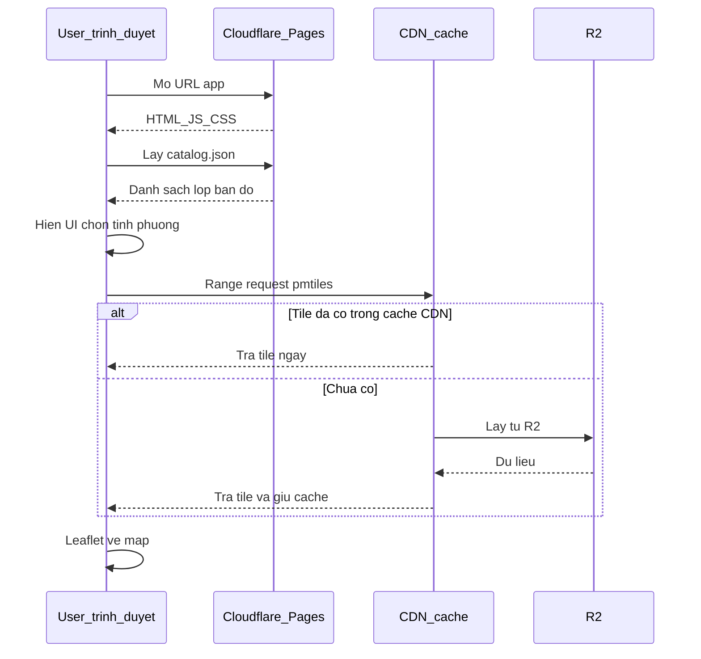

# Tech stack production — giải thích dễ hiểu

Tài liệu này giải thích **các công nghệ** và **luồng chạy** khi đưa app soi quy hoạch (kiểu demo Cầu Giấy) lên môi trường thật: nhiều người dùng, nhiều tỉnh, map vẫn mượt.

Viết cho người mới: mỗi khái niệm có ví dụ đời thường. Chi tiết làm dữ liệu PDF → tile xem [huong-dan.md](huong-dan.md). Pháp lý xem [phap-ly.md](phap-ly.md).

---

## 0. Bức tranh tổng thể (đọc trước)

Khi bạn mở Google Maps hoặc Guland, bạn **không** tải cả thế giới về máy. Trình duyệt chỉ tải những **ô ảnh nhỏ** (tile) đúng chỗ bạn đang nhìn, giống nhìn thành phố qua cửa sổ: chỉ thấy phần trong khung, kéo sang đâu mới tải thêm.

App của mình cũng vậy:

1. **Trang web** (nút bấm, panel, code React) — nhẹ.
2. **Ảnh quy hoạch đã cắt sẵn** (file `.pmtiles`) — nặng hơn, để riêng trên kho lưu trữ.
3. **Ảnh nền** (vệ tinh / đường phố) — lấy từ nhà cung cấp bản đồ.
4. **(Sau này)** máy chủ + database nếu cần “click đúng thửa”, đăng tin, đăng nhập.

**Production** = bản chạy thật trên internet cho nhiều user, không chỉ `localhost` hay demo một quận.

---

## 1. Từ điển nhanh (glossary)

Đọc bảng này trước khi xuống các mục sau. Gặp từ lạ → quay lại đây.

| Từ | Nghĩa đơn giản |
| --- | --- |
| **Frontend / SPA** | Phần chạy trong trình duyệt. SPA = Single Page App: một trang tải xong rồi tự đổi nội dung, không reload cả trang mỗi lần bấm. |
| **Vite + React** | Công cụ dựng giao diện. React = thư viện UI; Vite = đóng gói code để đưa lên mạng. |
| **Leaflet** | Thư viện vẽ bản đồ 2D trên web (kéo, zoom, lớp ảnh). Demo đang dùng cái này. |
| **MapLibre GL** | Thư viện bản đồ mạnh hơn Leaflet khi có **nhiều hình học vector** (hàng trăm nghìn thửa). Chưa cần ngay. |
| **Tile** | Một ô ảnh vuông nhỏ (thường 256×256 px) của bản đồ ở một mức zoom. Ghép nhiều ô = bản đồ. |
| **Raster** | Bản đồ dạng **ảnh** (pixel màu). PDF quy hoạch sau khi nắn → raster. Click đoán loại đất = đọc màu pixel. |
| **Vector** | Bản đồ dạng **hình học** (đường, đa giác) + thuộc tính (số tờ, mã đất). Click chính xác vào thửa. |
| **PMTiles** | **Một file** chứa hàng nghìn tile. Trình duyệt chỉ tải phần cần thiết trong file, không tải hết file. |
| **WEBP** | Định dạng ảnh nén tốt (nhỏ hơn PNG), dùng làm tile quy hoạch. |
| **HTTP Range** | Cách tải file “cắt lát”: “cho tôi byte 1000–2000”. PMTiles sống nhờ cái này. |
| **CDN** | Mạng máy chủ rải khắp nơi. User Việt Nam lấy file từ máy gần VN → nhanh hơn tải từ Mỹ. |
| **Cloudflare Pages** | Chỗ **host trang web** tĩnh (HTML/JS/CSS) miễn phí / rẻ, có CDN. |
| **Cloudflare R2** | Chỗ **cất file lớn** (giống tủ chứa S3). Dùng để chứa `.pmtiles` khi quá nặng cho Pages. |
| **Catalog** | File danh mục (`catalog.json`): liệt kê “có những lớp bản đồ nào, URL ở đâu”. App đọc catalog rồi mới tải đúng vùng. |
| **CORS** | Quy tắc trình duyệt: site A được phép tải file từ domain B không. R2 phải cho phép domain app của bạn. |
| **PostGIS** | Database Postgres có thêm hàm bản đồ (`ST_Contains`: điểm có nằm trong thửa không?). |
| **API** | Cửa sổ máy chủ: trình duyệt gửi “tọa độ click”, máy chủ trả “số tờ / viền thửa”. |
| **Cache / Cache-Control** | Lưu tạm file đã tải. Header bảo CDN/trình duyệt “giữ file này 1 năm vì không đổi”. |
| **Cluster** | Gộp nhiều chấm giá gần nhau thành một bóng “+12” khi zoom xa, tránh map đông đặc. |
| **Latency** | Độ trễ: từ lúc kéo map đến lúc ô mới hiện. Thấp = mượt. |
| **Egress** | Băng thông **đi ra** khi user tải file từ kho. Một số dịch vụ tính tiền theo GB tải ra. |
| **Static-first** | Ưu tiên phục vụ file tĩnh qua CDN; chỉ dùng máy chủ khi thật sự cần tính toán / ghi dữ liệu. |

---

## 2. Demo hiện tại đang làm gì? (để so với production)

### 2.1 Flow khi bạn mở demo

```text
Bạn mở trang
    → Trình duyệt tải HTML + JS (React)
    → Leaflet vẽ khung bản đồ
    → Tải ảnh vệ tinh Esri (ô z/x/y)
    → Tải file /data/cau-giay.pmtiles (một phần bằng Range)
    → Ghép các ô quy hoạch đè lên vệ tinh
    → (Tuỳ chọn) tải listings.json hiện chấm giá ảo
```

Mọi thứ chạy **trong trình duyệt**. Không có database, không có API đăng nhập. File quy hoạch nằm **cùng chỗ** với trang web (`web/public/data/`).

### 2.2 Demo vs production — bảng giải thích

| Việc | Demo bây giờ | Production nghĩa là gì |
| --- | --- | --- |
| Chỗ host trang | GitHub Pages hoặc máy bạn | **Cloudflare Pages**: đưa thư mục build lên, cả thế giới vào URL của bạn |
| File quy hoạch | Một file ~7 MB trong repo | Nhiều file lớn trên **R2**; trang chỉ giữ code nhẹ |
| Nhiều tỉnh/phường | Hard-code Cầu Giấy | **Catalog**: chọn vùng → mới tải đúng file |
| Nền đường phố | Esri (tiện cho demo) | Tự host OSM (Protomaps) hoặc nhà cung cấp có quyền dùng thương mại |
| Nền vệ tinh | Esri ghi nguồn (demo) | Phải có **hợp đồng / gói trả phí** nếu làm sản phẩm thật |
| Click đúng thửa pháp lý | Không có (user tự vẽ) | Database **PostGIS** + API |
| Tin giá thật | File JSON giả | Database + người dùng đăng |

---

## 3. Từng “tầng” công nghệ là gì?

Hình dung nhà hàng:

| Tầng | Ví dụ nhà hàng | Trong app map |
| --- | --- | --- |
| Giao diện | Thực đơn, bàn ghế khách thấy | React + Leaflet |
| Kho ảnh | Kho nguyên liệu lớn ở ngoại ô | R2 chứa PMTiles |
| Quầy phục vụ nhanh gần khách | Chi nhánh tiện lợi | CDN Cloudflare |
| Bếp tính toán đặc biệt | “Thửa này là tờ mấy?” | API + PostGIS |
| Sổ khách / tin đăng | Đặt bàn, ghi chú | Postgres + đăng nhập |

### 3.1 Frontend: Vite, React, Leaflet

- **React**: chia UI thành component (panel lớp, chú giải, map).
- **Vite**: lúc dev chạy nhanh; lúc deploy `pnpm build` ra thư mục `dist/` để upload.
- **Leaflet**: quản lý zoom, kéo map, chồng lớp. Demo có `PmtilesRasterLayer` (file `web/src/lib/pmtilesLayer.ts`) để vẽ tile lấy từ PMTiles.
- **Geoman**: công cụ vẽ đa giác (ranh thửa).
- **Turf**: tính diện tích, khoảng cách trên trình duyệt.
- **proj4**: đổi tọa độ WGS84 ↔ VN-2000.

Bạn **không** cần hiểu hết API của chúng để nắm kiến trúc: chỉ cần biết “toàn bộ UI + bản đồ chạy trên máy user”.

### 3.2 PMTiles — vì sao không để cả thành phố một ảnh khổng lồ?

Nếu đưa một ảnh GeoTIFF cả Hà Nội lên web:

- File có thể vài GB.
- User chỉ nhìn 2 km² cũng phải chờ tải hết — rất chậm, tốn tiền.

Cách làm đúng:

1. Cắt ảnh thành **ô tile** theo zoom (xa = ít ô thô; gần = nhiều ô nét).
2. Đóng tất cả ô vào **một file PMTiles** (như file zip thông minh).
3. Khi user nhìn một góc: thư viện hỏi “cho tôi vài ô này” bằng **Range** → chỉ tải vài KB–vài trăm KB mỗi lần kéo.

**WEBP**: mỗi ô nén nhỏ hơn PNG → file tổng nhẹ, tải nhanh hơn.

Demo một quận ~7–20 MB. Cả nước nếu nhét một file → hàng GB → **không làm vậy**. Phải **chia theo phường/tỉnh**.

### 3.3 Cloudflare Pages — chỗ để trang web

Sau `pnpm build`, bạn có thư mục `dist/` (HTML, JS, CSS).

**Pages** nhận thư mục đó và phát ra internet qua CDN. User mở `https://tenban.pages.dev` (hoặc domain riêng).

Giới hạn quan trọng: **mỗi file trên Pages tối đa 25 MiB**. File PMTiles 7 MB còn được; file 100 MB thì **không** upload vào Pages được → phải dùng R2.

### 3.4 Cloudflare R2 — tủ chứa file lớn

**R2** giống Google Drive / S3 cho lập trình viên:

1. Tạo “bucket” (thùng chứa).
2. Upload `cau-giay-v3.pmtiles`, `ba-dinh-v1.pmtiles`, …
3. Bật truy cập công khai (hoặc qua CDN) + CORS.
4. App chỉ cần biết URL: `https://files.domain-cua-ban.com/layers/cau-giay/v3.pmtiles`.

Vì sao hay dùng với Cloudflare:

- Gắn với CDN của họ → user gần đâu lấy từ đó.
- Mô hình giá thường **không tính egress** khi phục vụ qua mạng Cloudflare (vẫn kiểm tra bảng giá mới nhất).

**Demo chưa bắt buộc R2** vì file còn nhỏ. Production nhiều tỉnh → gần như chắc chắn cần R2.

### 3.5 Catalog — mục lục thư viện bản đồ

Không có catalog: code viết cứng “luôn mở Cầu Giấy”.

Có catalog: file JSON kiểu:

```json
{
  "layers": [
    {
      "id": "cau-giay-qhsdd-2030",
      "name": "QHSDĐ Cầu Giấy đến 2030",
      "url": "https://r2.example.com/layers/cau-giay/v3.pmtiles",
      "bounds": [105.76, 21.00, 105.81, 21.06]
    },
    {
      "id": "ba-dinh-qhsdd-2030",
      "name": "QHSDĐ Ba Đình đến 2030",
      "url": "https://r2.example.com/layers/ba-dinh/v1.pmtiles",
      "bounds": [105.80, 21.02, 105.85, 21.06]
    }
  ]
}
```

Flow:

1. App tải `catalog.json` (nhẹ, vài KB).
2. User chọn “Ba Đình” trên UI.
3. App mới mở URL PMTiles Ba Đình — **không** tải Cầu Giấy.

`v3` trong tên file = phiên bản. Cập nhật quy hoạch mới → upload `v4.pmtiles`, sửa catalog trỏ sang `v4`. CDN vẫn cache `v3` cũ thoải mái vì không ai hỏi `v3` nữa. Đây gọi là **versioned URL** (URL có số phiên bản).

### 3.6 CDN và Cache — vì sao map “nóng” lần sau nhanh hơn?

Lần đầu user A ở Hà Nội mở tile → máy Cloudflare gần VN lấy từ R2 rồi **giữ lại** (cache).

User B ở Hà Nội mở cùng ô → lấy ngay từ máy gần VN, không phải đọc lại R2 gốc.

Header `Cache-Control: public, max-age=31536000, immutable` nghĩa là: “file này không đổi, giữ cả năm”. Chỉ an toàn khi tên file có version (`v3.pmtiles`) hoặc hash trong tên JS.

### 3.7 HTTP Range — chi tiết một chút

Không có Range: trình duyệt phải `GET` cả file 50 MB rồi mới đọc.

Có Range: thư viện `pmtiles` nói:

- “Cho tôi 16 KB đầu” → biết cấu trúc file, danh sách tile ở đâu.
- “Cho tôi byte 1_200_000–1_201_024” → đúng một ô ảnh đang hiện trên màn hình.

R2 và Pages đều hỗ trợ Range. Nếu host nhầm chỗ không hỗ trợ Range → map quy hoạch **hỏng**.

### 3.8 Nền vệ tinh và nền đường phố

Map có nhiều lớp chồng:

```text
[ trên ]  Chấm giá, viền thửa vẽ tay
          Lớp quy hoạch (PMTiles mờ 60%)
[ dưới ]  Ảnh vệ tinh hoặc bản đồ đường
```

- **Vệ tinh**: nhìn mái nhà, đường thật — tiện vẽ thửa. Nhà cung cấp (Esri, Google, Mapbox…) có **điều khoản**. Demo ghi nguồn Esri; sản phẩm thương mại phải trả tiền / đăng ký gói.
- **Đường phố**: kiểu Google Map có tên đường. OSM miễn phí dữ liệu nhưng **cấm** dùng server tile `tile.openstreetmap.org` cho sản phẩm. Cách đúng: tự host (Protomaps → PMTiles trên R2) hoặc mua dịch vụ.

### 3.9 Leaflet vs MapLibre — khi nào đổi?

| Bạn đang làm | Dùng |
| --- | --- |
| Ảnh quy hoạch đè lên vệ tinh + vẽ 1 polygon + vài trăm chấm giá | **Leaflet** (như demo) — đủ |
| Hiển thị **mọi thửa** cả quận cùng lúc (hàng chục/trăm nghìn đa giác) | **MapLibre** + vector tiles |
| Cần nghiêng bản đồ 3D, label phức tạp | MapLibre |

Đừng đổi MapLibre chỉ vì “nghe hiện đại”. Đổi khi Leaflet bắt đầu giật.

**Vector tiles (MVT)**: thay vì gửi cả GeoJSON khổng lồ, cắt vector thành ô theo zoom (giống tile ảnh nhưng chứa đường/polygon). Tippecanoe là công cụ tạo MVT phổ biến.

### 3.10 PostGIS và API — chỉ khi cần “đúng thửa”

Demo: click map → đọc **màu** ảnh quy hoạch → đoán mã đất. Sai số / trùng màu có thể xảy ra. User vẽ thửa = tự khoanh, **không** có số tờ/số thửa pháp lý.

Sản phẩm giống Guland (viền đỏ + số tờ):

1. Có dữ liệu vector địa chính **hợp pháp** trong database.
2. User click → trình duyệt gửi `{ lat, lng }` tới **API**.
3. API hỏi PostGIS: “đa giác nào chứa điểm này?” (`ST_Contains`).
4. Trả về: tọa độ viền + số tờ + số thửa → Leaflet vẽ polygon đỏ.

**Cloudflare Workers**: đoạn code nhỏ chạy sát CDN, phù hợp API mỏng (nhận tọa độ → gọi DB → trả JSON).  
**Node trên VPS**: máy chủ truyền thống, dễ gắn PostGIS nếu Workers không đủ.

Raster quy hoạch **chỉ để xem** thì **chưa cần** PostGIS.

### 3.11 Tin giá và cluster

- Ít hơn ~100–200 điểm: vẽ chấm tròn như demo được.
- Hàng nghìn tin: phải **cluster** (gom nhóm) hoặc chỉ tải tin trong khung nhìn (bbox).
- Tin thật: lưu Postgres, có đăng nhập, kiểm duyệt — không crawl sàn khác.

### 3.12 Quan sát lỗi (observability)

- **Web Analytics**: biết bao nhiêu người vào, trang nào.
- **Sentry**: khi JS crash hoặc API lỗi, gửi báo cáo kèm stack — để sửa trước khi user complain.

---

## 4. Flow đầy đủ khi user dùng bản production

### 4.1 Lần đầu mở trang



Diễn giải từng bước:

1. User mở domain → Pages trả SPA.
2. SPA fetch `catalog.json` → biết có những lớp nào.
3. Theo tỉnh mặc định hoặc lựa chọn user → biết URL `.pmtiles`.
4. Leaflet + thư viện pmtiles xin các ô trong màn hình (Range).
5. Song song, lớp nền vệ tinh tải ô từ nhà cung cấp.
6. Map hiện: nền + quy hoạch mờ + (nếu bật) chấm giá.

### 4.2 User kéo / zoom map

Mỗi lần khung nhìn đổi, Leaflet hủy ô cũ ngoài màn hình, xin ô mới. **Không** tải lại cả file PMTiles. Đây là lý do map “nhẹ” dù kho dữ liệu lớn.

### 4.3 User chọn tỉnh khác

1. Đọc catalog → URL PMTiles mới.
2. Gỡ lớp quy hoạch cũ.
3. Gắn lớp mới + `fitBounds` theo `bounds` trong catalog.
4. Không đụng tới file tỉnh trước.

### 4.4 User click soi thửa (giai đoạn sau, có PostGIS)

```text
Click (lat, lng)
  → POST /api/parcel { lat, lng }
  → PostGIS ST_Contains
  → JSON { soTo, soThua, polygon: [...] }
  → Leaflet vẽ L.polygon màu đỏ + hiện panel
```

### 4.5 Bạn (team) cập nhật dữ liệu quy hoạch mới

```text
Chạy lại pipeline data-prep (PDF → PMTiles)
  → Upload lên R2: layers/cau-giay/v4.pmtiles
  → Sửa catalog.json: url trỏ v4
  → Deploy Pages (nếu catalog nằm cùng app)
  → User mới tự lấy v4; CDN không cần xóa tay từng tile cũ
```

---

## 5. Làm sao map nhanh và chịu nhiều người?

### 5.1 Nguyên tắc static-first

Hãy tưởng tượng 1000 người cùng mở map:

- Nếu **mỗi ô tile** phải đi qua máy chủ Node của bạn → máy chủ chết.
- Nếu mỗi ô lấy từ **CDN** → 1000 người lấy từ hàng trăm máy edge → ổn.

Vì vậy: tile và SPA = tĩnh trên Pages/R2/CDN. Máy chủ chỉ làm việc “hiếm” hơn: đăng nhập, đăng tin, query thửa.

### 5.2 Việc nên làm

| Việc | Lý do |
| --- | --- |
| Chia PMTiles theo phường/tỉnh | User Hà Nội không tải data Đà Nẵng |
| WEBP + zoom 12–18 | File nhỏ, đủ nét cho quy hoạch giấy |
| Versioned URL + cache dài | Lần 2 trở đi gần như tức thì |
| Chỉ bật lớp đang cần | Ít request song song |
| Cluster tin giá | Ít DOM / ít marker |
| Index GIST trên PostGIS | Query thửa không full-scan |

### 5.3 Việc tránh

| Việc | Hệ quả |
| --- | --- |
| Một file PMTiles cả nước | Chậm, khó cập nhật, Range lần đầu nặng |
| Proxy mọi tile qua API Node | Tốn CPU, dễ quá tải |
| Đổ 50.000 GeoJSON thửa vào Leaflet | Tab trình duyệt đơ |
| Host PMTiles chỗ không hỗ trợ Range | Lớp quy hoạch không chạy |
| Dùng tile OSM.org chính thức cho sản phẩm | Vi phạm điều khoản OSM |

### 5.4 Bottleneck thường gặp (và cách nghĩ)

1. **Lần đầu mở vùng mới chậm** — bình thường: CDN chưa có cache. Lần sau nhanh hơn. Giảm bằng chia file nhỏ hơn.
2. **API soi thửa chậm** — thiếu index geometry, hoặc query quá rộng. Sửa DB, không “thêm server lung tung”.
3. **JS bundle lớn** — code frontend phình. Code-split, chỉ load Geoman khi vào tab vẽ.

---

## 6. Stack chốt theo lớp (nhắc lại có giải thích)

| Lớp | Chọn | Vì sao |
| --- | --- | --- |
| UI map | Vite + React + **Leaflet** | Đủ cho raster + vẽ thửa; team đã có trong demo |
| Map nặng vector | **MapLibre** sau này | GPU + vector tiles khi thửa dày |
| Tile QH | **PMTiles** WEBP trên **R2** | Một file, Range, CDN, vượt 25 MiB Pages |
| Host app | **Cloudflare Pages** | SPA tĩnh + CDN |
| Đa vùng | **catalog.json** | Chọn mới tải |
| Nền đường | OSM PMTiles tự host (Protomaps) trên R2 | Không lệ thuộc tile OSM.org |
| Nền vệ tinh | ArcGIS / tương đương **trả phí thương mại** | Hợp pháp khi public |
| Thửa / % QH vector | **PostGIS** + Workers hoặc Node | Tính toán không gian đúng |
| Tin đăng | Postgres + auth | User-generated |
| Theo dõi | Web Analytics + Sentry | Biết lỗi và traffic |

---

## 7. Làm theo giai đoạn (đừng dựng hết ngày đầu)

### Giai đoạn A — MVP public (gần demo)

- Pages host SPA.
- 1–vài file PMTiles (Pages nếu &lt; 25 MiB, không thì R2).
- Catalog đơn giản hoặc vài URL cấu hình.
- Leaflet như hiện tại.
- Disclaimer + giấy phép nền bản đồ tối thiểu.

**Chưa cần:** PostGIS, đăng nhập, MapLibre.

### Giai đoạn B — Có tin user

- Thêm database + đăng nhập.
- Cluster marker.
- Kiểm duyệt tin.

### Giai đoạn C — Có địa chính / % quy hoạch vector

- Xin dữ liệu hợp pháp ([phap-ly.md](phap-ly.md)).
- PostGIS + API.
- Click thửa / giao diện tích.

### Giai đoạn D — Nhiều tỉnh, traffic lớn

- Catalog đầy đủ, mọi archive trên R2.
- Cache và versioning nghiêm.
- MapLibre nếu vector dày.
- Rate limit API, Sentry, theo dõi chi phí.

Chi phí free tier tham khảo: [huong-dan.md §8](huong-dan.md).

---

## 8. Checklist go-live kỹ thuật (checkbox)

In ra và tick trước khi mở cho đông user:

**Trang web**

- [ ] Deploy lên Cloudflare Pages (hoặc tương đương có CDN).
- [ ] Có HTTPS và domain ổn định.

**Tile quy hoạch**

- [ ] File `.pmtiles` nằm đúng chỗ (Pages nếu nhỏ, **R2** nếu lớn).
- [ ] Thử trên trình duyệt: lớp quy hoạch hiện khi zoom.
- [ ] DevTools → Network: thấy request có header `Range` và status `206 Partial Content` (hoặc 200 có Accept-Ranges).
- [ ] CORS: app domain được phép đọc file từ R2.

**Đa vùng**

- [ ] Có `catalog.json` (hoặc tương đương); không hard-code một quận trong code production.
- [ ] Đổi phiên bản dữ liệu bằng URL mới (`v4`), không ghi đè tên cũ đang cache lung tung.

**Nền bản đồ**

- [ ] Không dùng `tile.openstreetmap.org` cho sản phẩm.
- [ ] Vệ tinh đúng gói thương mại nếu public/thu phí.

**Hiệu năng**

- [ ] Mỗi vùng đang mở: archive PMTiles kích thước hợp lý (ưu tiên vài chục MB, không hàng GB).
- [ ] Chỉ tải lớp user bật.

**API (nếu đã có)**

- [ ] Health check.
- [ ] Rate limit endpoint ghi / soi thửa.
- [ ] Geometry có index (GIST).
- [ ] Log lỗi (Sentry).

**Pháp lý**

- [ ] Đã đọc và tick checklist trong [phap-ly.md](phap-ly.md).

---

## 9. Liên kết trong repo

| File | Đọc khi nào |
| --- | --- |
| [huong-dan.md](huong-dan.md) | Cách tạo PMTiles từ PDF, chạy demo, chi phí |
| [phap-ly.md](phap-ly.md) | Xin dữ liệu QH / địa chính hợp pháp |
| [data-prep/README.md](../data-prep/README.md) | Nắn tọa độ VN-2000 |
| `web/src/lib/pmtilesLayer.ts` | Code Leaflet đọc PMTiles |
| `web/src/lib/mapConfig.ts` | URL lớp quy hoạch / district / listings |

---

## 10. Tóm tắt bằng lời thường

1. **Trang web** nhẹ → Cloudflare Pages.  
2. **Ảnh quy hoạch** nặng → cắt tile, đóng PMTiles, để Cloudflare R2, phát qua CDN.  
3. **Nhiều tỉnh** → file mục lục catalog, chọn đâu tải đó.  
4. **Nhanh** nhờ chỉ tải ô đang nhìn + cache gần user.  
5. **Đúng thửa pháp lý** → sau này mới thêm PostGIS + API; demo chưa cần.  
6. **Leaflet** đủ lâu; **MapLibre** khi vector quá dày.  
7. **Đừng** cào Guland và **đừng** nhét cả nước một file.

Nếu chỉ nhớ một câu: *production = để CDN phục vụ ảnh bản đồ, còn máy chủ chỉ làm việc khi thật sự phải tính toán hoặc lưu dữ liệu người dùng.*
